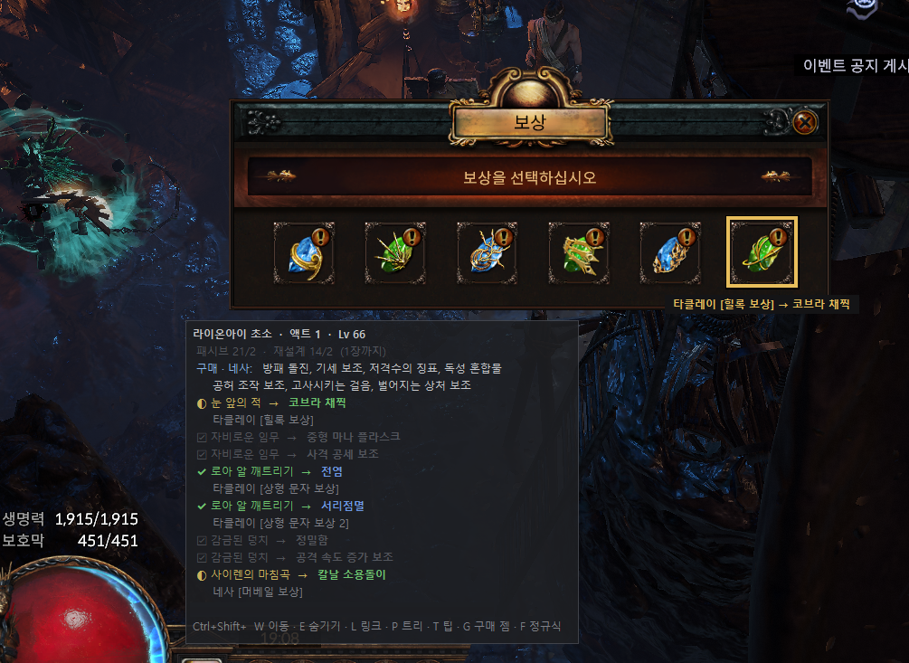
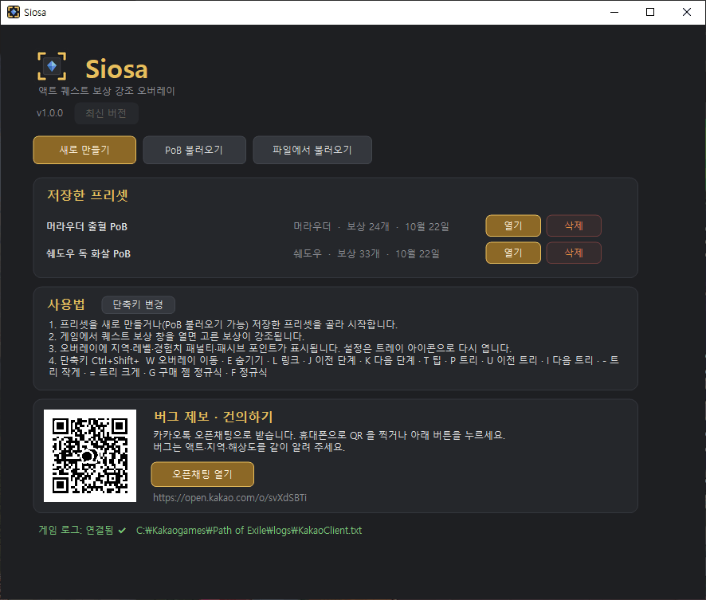
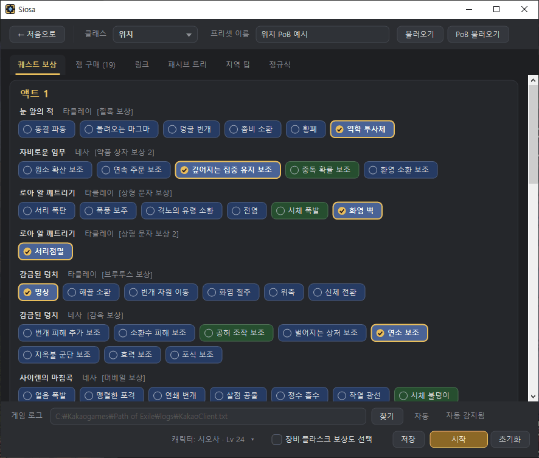
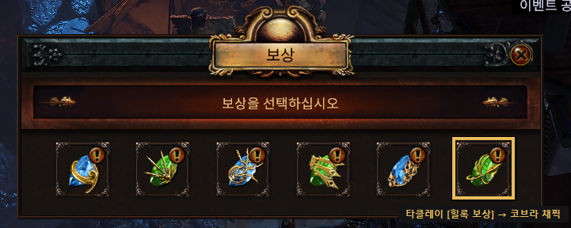
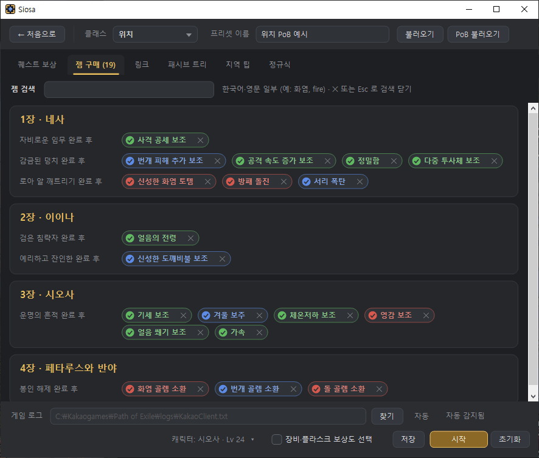
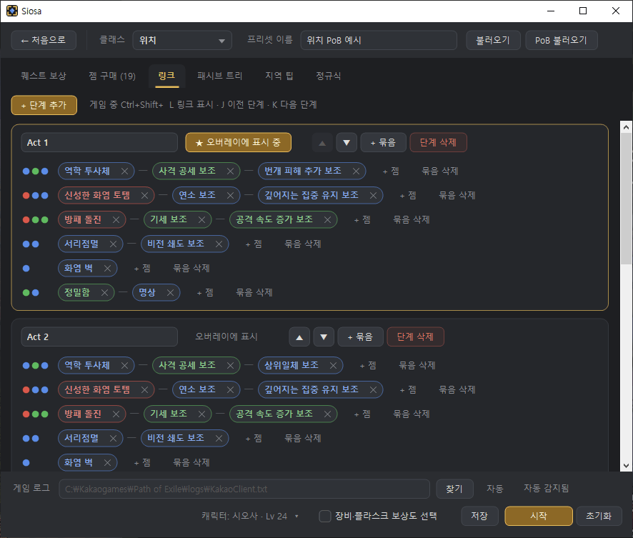
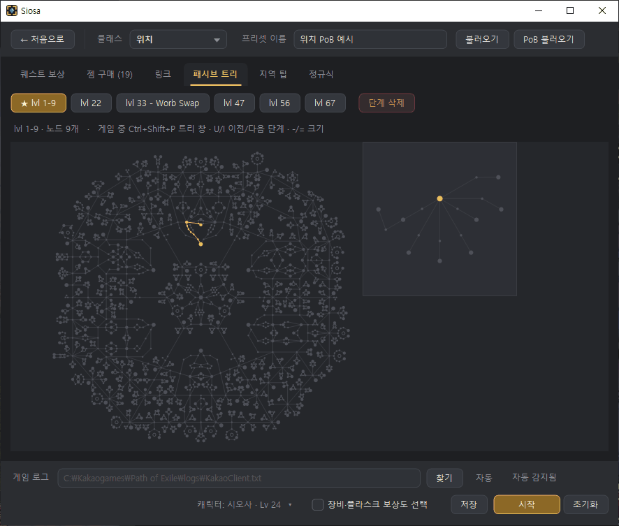
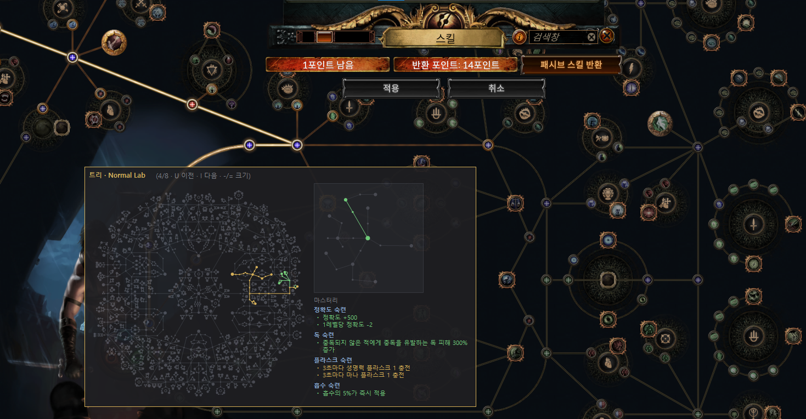
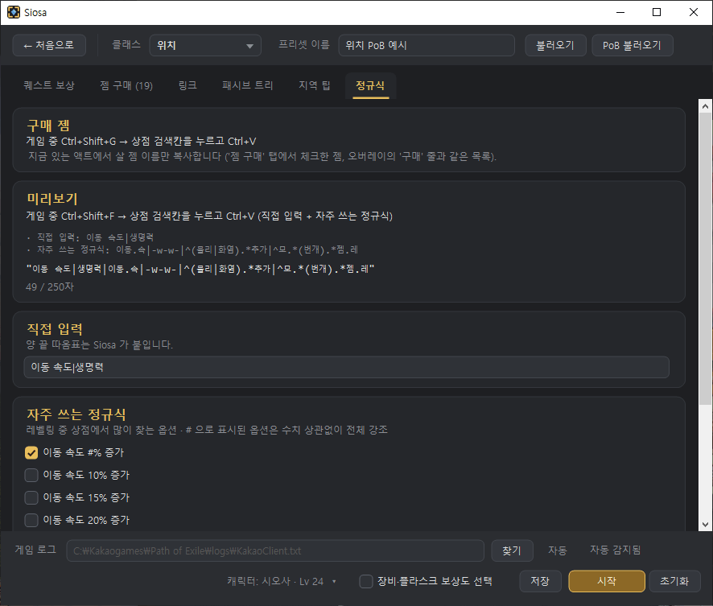
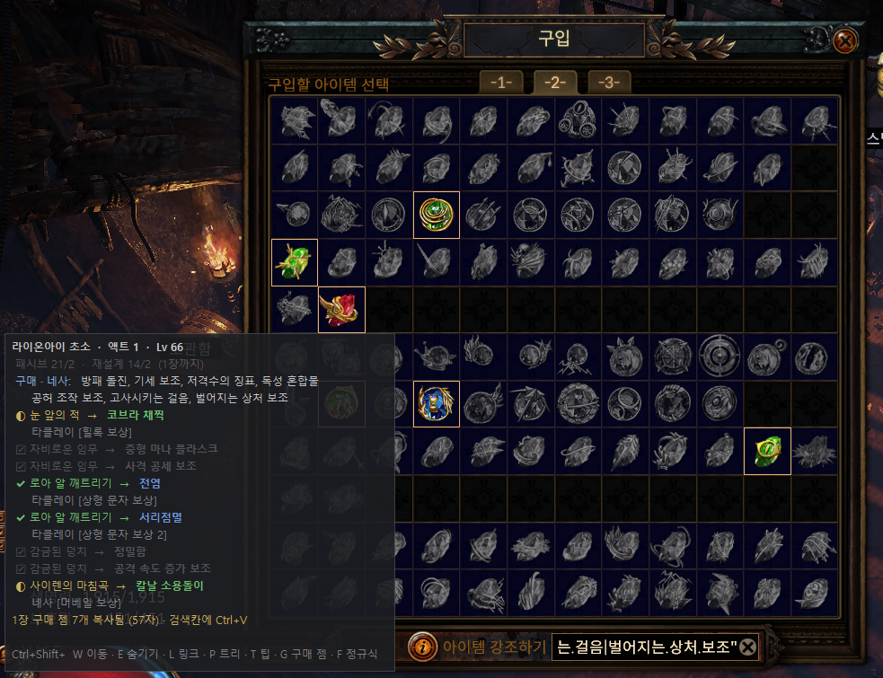

<p align="center">
  
</p>

<h1 align="center">Siosa</h1>

<p align="center">
  Path of Exile 1 <b>카카오 한국 클라이언트</b>용 액트(캠페인) 진행 보조 오버레이<br>
  퀘스트 보상 강조 · 구매할 젬 · 링크 · 패시브 트리 · 지역 팁 · 상점 검색 정규식
</p>

<p align="center">
  <a href="https://github.com/nwangxyz/siosa/releases/latest"><b>⬇ 최신 버전 받기</b></a> ·
  <a href="https://open.kakao.com/o/svXdSBTi">버그 제보 · 건의 (카카오톡 오픈채팅)</a>
</p>

---

## 이런 걸 해 줍니다

- **퀘스트 보상 강조** — 미리 골라 둔 보상을 보상 창에서 바로 표시합니다. (PoB 를 불러오면 자동으로 골라 줍니다)
- **진행 상황 오버레이** — 지금 지역·레벨, 경험치 패널티, 받은 패시브 포인트, 이 액트에서 받을 보상과 살 젬을 보여 줍니다.
- **링크·패시브 트리** — PoB 의 단계별 젬 링크와 패시브 트리를 게임 중에 띄워 봅니다.
- **지역 팁** — 지역에 들어가면 길 찾기 팁을 한 줄로 보여 줍니다.
- **상점 검색 정규식** — 단축키 한 번으로 이 액트에서 살 젬, 자주 찾는 옵션을 검색칸에 붙여 넣을 수 있게 복사합니다.

> **안전**: 게임 입력(키보드·마우스)을 읽거나 보내지 않습니다. **화면 일부와 게임 로그 파일만** 읽습니다.

<p align="center"></p>

---

## 설치 (포터블)

1. [Releases](https://github.com/nwangxyz/siosa/releases/latest) 에서 `Siosa-v<버전>.zip` 을 받아 원하는 곳에 풉니다.
2. `Siosa.exe` 를 실행합니다. **설치가 필요 없고, 프로그램은 exe 파일 하나**입니다.

> **처음 실행할 때 "Windows의 PC 보호" 창이 뜨면** `추가 정보` → `실행` 을 누르세요.
> 인터넷에서 받은 서명 없는 프로그램에 Windows(SmartScreen)가 띄우는 안내입니다. 한 번 실행하면 다음부터는 뜨지 않습니다.
> 소스 코드는 이 저장소에 모두 공개되어 있습니다.

- 필요: Windows 10/11 (.NET Framework 4.8 — Windows 10 이상에는 기본으로 들어 있습니다)
- 처음 실행하면 exe 옆에 `SiosaData` 폴더가 생기고, 설정·프리셋·진행 기록이 모두 여기에 저장됩니다.
  **다른 곳으로 옮길 때는 `Siosa.exe` 와 `SiosaData` 를 같이** 옮기면 그대로 이어집니다.
- 게임 로그(`logs\KakaoClient.txt`)는 자동으로 찾습니다. 못 찾으면 설정 아래쪽 `찾기`로 직접 지정하세요.

```
Siosa\
├─ Siosa.exe          프로그램 (게임 데이터 포함)
├─ README.txt         안내
└─ SiosaData\         처음 실행하면 생김
   ├─ settings.json   설정
   ├─ profiles\       저장한 프리셋
   └─ progress\       캐릭터 진행 기록
```

---

## 사용법

### 1. 프리셋 만들기



- **PoB 불러오기**: PoB 코드나 pobb.in 링크를 넣으면 직업·보상·구매 젬·링크·패시브 트리를 한 번에 가져옵니다.
- **새로 만들기**: 직업을 고르고 보상을 직접 고릅니다.
- 저장한 프리셋은 메인 화면 목록에서 `열기`로 다시 엽니다.

### 2. 보상 고르기



액트별로 퀘스트 보상을 고릅니다. 금색 테두리가 고른 보상입니다. 아래 `장비·플라스크 보상도 선택`을 켜면 장비 보상도 고를 수 있습니다.

### 3. 시작

아래 `시작`을 누르면 설정창이 닫히고 오버레이가 뜹니다. 설정을 다시 열 때는 **트레이 아이콘을 더블클릭**하세요. (설정창을 여는 동안은 오버레이가 잠시 멈추고, 그사이 게임 진행은 다시 시작할 때 이어서 반영됩니다)

### 게임 중



- 보상 NPC 와 대화해 **보상 창을 열면** 고른 보상 칸이 강조됩니다.
- 오버레이에는 지역·레벨, 경험치 패널티(`캐릭터 Lv a~b면 패널티 없음`), 지역 팁, 패시브 포인트(받은/받을 수)가 보이고,
  **마을과 보상 NPC 가 있는 곳에서만** 받을 보상과 살 젬 목록이 보입니다.

---

## 탭 소개

| 탭 | 내용 |
|---|---|
| 퀘스트 보상 | 액트별 보상 고르기 |
| 젬 구매 | 상점에서 살 젬 (PoB 에서 자동, 직접 추가 가능). 체크한 젬만 오버레이·정규식에 들어감 |
| 링크 | 단계(Act 1, 8Lv …)별 젬 링크. 게임 중 `Ctrl+Shift+L` 로 표시 |
| 패시브 트리 | PoB 의 트리 단계. 게임 중 `Ctrl+Shift+P` 로 트리 창 |
| 지역 팁 | 지역별 한 줄 팁 고치기 (모든 프리셋 공통, 비우면 숨김) |
| 정규식 | 상점 검색칸에 붙여 넣을 정규식 |

<details>
<summary><b>젬 구매 · 링크 · 패시브 트리 화면</b></summary>

<br>
<br>



</details>

### 상점 검색 정규식



- `Ctrl+Shift+G` — **지금 액트에서 살 젬** 이름을 복사합니다.
- `Ctrl+Shift+F` — **직접 입력 + 자주 쓰는 정규식**(이동 속도, 링크, 피해 추가 …)을 복사합니다.
- 상점 창의 검색칸을 누르고 `Ctrl+V` 로 붙여 넣으면 해당 아이템이 강조됩니다.
- 목록에 없는 검색은 `직접 입력` 칸에 넣으면 같이 복사됩니다.



---

## 단축키

모두 `Ctrl+Shift+` 조합이며 메인 화면 `단축키 변경`에서 바꿀 수 있습니다.

| 키 | 기능 | 키 | 기능 |
|---|---|---|---|
| `W` | 오버레이 위치 옮기기 (다시 누르면 고정) | `P` | 패시브 트리 창 |
| `E` | 오버레이 숨기기/보이기 | `U` / `I` | 이전 / 다음 트리 단계 |
| `L` | 링크 표시 | `-` / `=` | 트리 창 작게 / 크게 |
| `J` / `K` | 이전 / 다음 링크 단계 | `G` | 구매 젬 정규식 복사 |
| `T` | 지역 팁 켜기/끄기 | `F` | 정규식 복사 |

---

## 업데이트

메인 화면 이름 아래에 새 버전이 표시되면 **`업데이트` 버튼**을 누르세요. 새 `Siosa.exe` 를 받아 바꾼 뒤 자동으로 다시 시작합니다.

- 진행 창이 뜨고, 끝나면 Siosa 가 종료된 뒤 새 버전이 자동으로 실행됩니다.
- `SiosaData` (설정·프리셋·진행 기록)는 그대로 남습니다.
- 직접 받아도 됩니다: 새 zip 의 `Siosa.exe` 로 덮어쓰면 됩니다.

---

## 자주 묻는 것

- **보상 강조가 안 돼요** — 해상도와 화면 모드(전체 화면·창 모드)를 같이 제보해 주세요.
  (확인된 해상도: 1280×720 · 1366×768 · 1440×900 · 1680×720 · 1920×1080 · 2560×1440, 창 모드 포함)
- **다른 캐릭터로 기록돼요** — 프리셋 하나 = 캐릭터 하나입니다. 편집 화면 아래 `캐릭터 ▾` 에서
  `이전 진행 불러오기`(키우던 캐릭터 고르기) 또는 `새 캐릭터로 시작`을 쓰세요.
- **오버레이가 화면 밖에 있어요** — 모니터가 바뀌면 자동으로 기본 위치로 돌아옵니다. `Ctrl+Shift+W` 로 옮길 수 있습니다.

---

## 버그 제보 · 건의

카카오톡 오픈채팅: **https://open.kakao.com/o/svXdSBTi** (프로그램 메인 화면에도 QR 이 있습니다)
액트·지역·해상도를 같이 알려 주시면 빨리 고칠 수 있습니다.

## 라이선스

[MIT](LICENSE) · Path of Exile 및 관련 이름·데이터·이미지는 Grinding Gear Games 의 것입니다.
이 프로그램은 Grinding Gear Games · 카카오게임즈와 관계없는 팬 제작 도구입니다.

개발 문서: [docs/DEVELOPMENT.md](docs/DEVELOPMENT.md)
